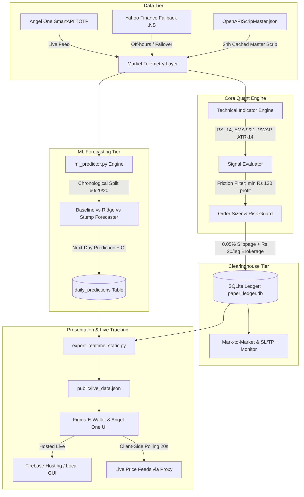

# IndianPaperTrader: Autonomous NSE/BSE Paper-Trading MCP Engine

[](https://github.com/Kapildas9057/indian-paper-trader)
[](https://indian-paper-trader-nse.web.app/)
[](https://www.nseindia.com/)
[](https://modelcontextprotocol.io/)
[](https://www.python.org/)

**IndianPaperTrader** is an autonomous, air-gapped quantitative paper-trading engine and real-time portfolio tracker built for the Indian stock market (NSE/BSE). Powered by the **Model Context Protocol (MCP)**, it enables AI agents (Google Antigravity, Gemini, Hermes) to stream live market telemetry, compute technical indicators, run chronological machine learning price forecasts, and execute simulated trades against a friction-accurate ₹1,00,000.00 SQLite virtual clearinghouse—**without risking a single rupee of real capital**.

---

## 🌐 Live Deployments & Links

- **Live Web Dashboard:** [https://indian-paper-trader-nse.web.app/](https://indian-paper-trader-nse.web.app/)
- **GitHub Repository (Public):** [https://github.com/Kapildas9057/indian-paper-trader](https://github.com/Kapildas9057/indian-paper-trader)
- **Local Dashboard:** `http://127.0.0.1:8765/` (when running `gui_dashboard.py`)
- **Local ML Admin Panel:** `http://127.0.0.1:8765/admin`

---

## 📐 System Architecture



---

## 🧩 Comprehensive Module Breakdown

### 1. `indian_paper_mcp.py` — Core MCP Server & Paper Clearinghouse
The primary server implementing the FastMCP protocol (`MCPServer` in MCP 2.x):
- **Telemetry Feeder (`ReadOnlyMarketClient`):** Reads live tick & OHLC data from Angel One SmartAPI using TOTP authentication. If credentials are not supplied, or outside market hours (09:15–15:30 IST), it seamlessly falls back to `yfinance` (`.NS`/`.BO`).
- **Scrip Master Resolution:** Automatically downloads and caches NSE/BSE contract master instruments (`OpenAPIScripMaster.json`) with a 24-hour TTL, providing sub-2ms token-to-symbol resolution.
- **Quant Indicator Engine (`compute_indicators`):** Vectorized computations for:
  - **RSI-14:** Wilder's smoothed Relative Strength Index.
  - **EMA 9 & EMA 21:** Exponential Moving Average crossover detection.
  - **Session VWAP:** Intraday volume-weighted average price benchmark.
  - **ATR-14:** Average True Range for dynamic volatility stop-loss (1.5x ATR) and take-profit (3.0x ATR) scaling (2.0:1 reward-to-risk ratio).
- **SQLite Clearinghouse (`paper_ledger.db`):** 
  - Simulates execution drag with **0.05% slippage**.
  - Deducts standard Indian discount brokerage (**₹20.00 flat per buy/sell leg**).
  - Enforces the **₹120.00 Minimum Edge Hurdle** (3x round-trip brokerage) before any trade can be placed.
  - Clamps risk exposure strictly between **2.0% and 15.0%** of total portfolio equity.
- **Mark-to-Market Auto-Sweep:** Continually compares open positions against live market High/Low prices to execute automated Stop-Loss and Take-Profit exits.

---

### 2. `ml_predictor.py` — Chronological ML Forecasting Engine
Built adhering strictly to `ml-best-practices` to prevent data leakage and ensure real quantitative utility:
- **Stationarity Transformation:** Raw prices have strong unit roots (autocorrelation >0.97). This module converts prices into percentage returns and lag features, reducing autocorrelation below 0.15.
- **Leak-Free Chronological Splitting:** Enforces strict sequential order (60% Train, 20% Validation, 20% Test). No shuffling or cross-sectional random splitting.
- **Safe Preprocessing:** Implements `StandardScalerStrict` where statistics ($\mu, \sigma$) are fit *only* on the training set and applied without modification downstream.
- **Model Tournament:** Concurrently trains and compares 3 models:
  1. `NaiveDriftBaseline`: Rolling drift momentum baseline.
  2. `RidgeForecaster`: Regularized linear regression with L2 shrinkage.
  3. `GradientBoostedStumpForecaster`: Non-linear ensemble of decision trees.
- **Statistical Significance Testing:** Computes 95% bootstrap confidence intervals for MSE, MAE, and directional accuracy. Only models demonstrating a genuine edge over the baseline produce forward-looking predictions saved into the `daily_predictions` table.

---

### 3. `autonomous_runner.py` — 5-Phase "COOK" Autonomous Loop
The orchestration script that executes the autonomous trading cycle:
- **Phase 1 (Mark-to-Market Sweep):** Inspects `paper_ledger.db`, updates unrealized P&L against live ticks, and records any SL/TP exits.
- **Phase 2 (Watchlist Technical Scan):** Analyzes high-beta Nifty 50 constituents (`RELIANCE-EQ`, `TCS-EQ`, `HDFCBANK-EQ`, `INFY-EQ`, `ICICIBANK-EQ`, `SBIN-EQ`).
- **Phase 3 (Friction-Aware Order Execution / Replay):** Executes qualified setups with expected gross profit > ₹120.00. Outside trading hours or on zero signals, executes a 15-day backtest replay simulation.
- **Phase 4 (Self-Improvement Reflection):** Automatically reviews closed trades and backtest win rates, writing quantitative insights to [MEMORY.md](file:///d:/trading%20bot%20for%20skl/MEMORY.md) and tuning parameters in [strategy_config.json](file:///d:/trading%20bot%20for%20skl/strategy_config.json).
- **Phase 5 (ML Next-Day Prediction & Verification):** Compares past forecasts against actual market closes, grades prediction accuracy, and forecasts next-session targets.

---

### 4. `export_realtime_static.py` — State Serializer
Bridges the Python trading engine with web user interfaces:
- Queries SQLite for active positions, virtual cash, and closed trade totals.
- Fetches real-time market prices, today's point changes, and calculates aggregate metrics (Invested Capital, Unrealized P&L, Expected Growth).
- Constructs a 36-period historical equity performance curve.
- Outputs a normalized JSON payload to [public/live_data.json](file:///d:/trading%20bot%20for%20skl/public/live_data.json).

---

### 5. `public/index.html` — Web App (Figma E-Wallet & Angel One UI)
A responsive mobile-first frontend inspired by the **Figma E-Wallet Mobile App Design (`dvKdKNfU9XXIt6y6I09b9I`)** and **Angel One Portfolio**:
- **Deep Violet Header & 4-Pillar Metric Grid:** Live Net Worth, Available Virtual Cash, Total Invested, and Total P&L.
- **Dual Wallet Cards:** Indigo/Purple cards showing Available Balance vs. Total Portfolio Value with account badges.
- **Dynamic Charting:**
  - **Angel One SVG Intraday MTM Curve:** Smooth cubic bezier performance curve with active fill.
  - **Figma Statistic Stock Pillars:** 3-bar comparative columns showing *Invested* vs. *Current Value* vs. *Expected Target*.
- **Holdings Cards:** Line-item breakdown for active stocks (`TCS-EQ`, `HDFCBANK-EQ`, `SBIN-EQ`) showing Quantity, Avg Price, LTP, SL, TP, and ML Next-Day Forecast.
- **Real-Time Client-Side Polling:** Refreshes quotes every 20 seconds using a client-side CORS fallback proxy (`api.allorigins.win`), dynamically updating values and green/red flash indicators without requiring page reloads.

---

### 6. `gui_dashboard.py` — Local HTTP Server & Admin Panel
Runs a lightweight multi-threaded HTTP server on `http://127.0.0.1:8765`:
- `GET /`: Serves the primary portfolio frontend.
- `GET /admin`: Serves an interactive quantitative control panel showing database records, ML model scorecards, and strategy parameters.
- `POST /api/run-cycle`: Triggers an immediate 5-phase trading cycle from the browser.
- `POST /api/train-predict`: Retrains the ML models and updates forecasts on demand.
- `POST /api/verify-predictions`: Runs real-time evaluation of ML predictions against live prices.

---

### 7. `.github/workflows/autonomous_tracker.yml` — Automated Cloud Cron
GitHub Actions workflow executing on schedule:
- Runs every 30 minutes during NSE market hours (`*/30 3-10 * * 1-5`, 09:00–16:00 IST Monday to Friday).
- Sets up Python, installs dependencies, runs the 5-phase autonomous cycle, tests ML predictions, rebuilds `public/live_data.json`, and commits updated portfolio state back to GitHub.

---

## 🔒 Safety & Air-Gap Guarantees (NFR-01)

1. **Zero Broker Execution Risk:** The codebase contains **0 occurrences** of live broker order endpoints (`placeOrder`, `modifyOrder`, `cancelOrder`). All positions exist exclusively within `paper_ledger.db`.
2. **Anti-Churn Hurdle:** A strict rule rejects trades unless expected gross profit to target exceeds **₹120.00** (3x round-trip brokerage).
3. **Strict Exposure Clamps:** Risk per trade is bounded between **2.0% and 15.0%** of current equity, preventing portfolio blowout during high-volatility events.

---

## 🚀 Quickstart Guide

### 1. Installation

```powershell
# Clone the public repository
git clone https://github.com/Kapildas9057/indian-paper-trader.git
cd indian-paper-trader

# Create virtual environment and install dependencies
python -m venv .venv
.\.venv\Scripts\pip.exe install -r requirements.txt
```

### 2. Run the Autonomous Trading & ML Cycle

```powershell
# Run the 5-Phase autonomous cycle (Mark-to-market, Scan, Execute/Replay, Reflect, Predict)
.\.venv\Scripts\python.exe autonomous_runner.py --mode direct --verify-predictions
```

### 3. Launch the Local GUI Dashboard

```powershell
# Export latest portfolio snapshot to public/live_data.json
.\.venv\Scripts\python.exe export_realtime_static.py

# Launch GUI server (open http://127.0.0.1:8765 in your browser)
.\.venv\Scripts\python.exe gui_dashboard.py --port 8765
```

### 4. Connect as an MCP Server

Add to your MCP settings file (`.gemini/settings.json` or `.agents/mcp_config.json`):

```json
{
  "mcpServers": {
    "indian-paper-trader": {
      "command": "python",
      "args": ["-u", "indian_paper_mcp.py"],
      "env": {
        "PYTHONUNBUFFERED": "1"
      }
    }
  }
}
```

---

## 📁 Repository Structure

```
indian-paper-trader/
├── .github/
│   └── workflows/
│       └── autonomous_tracker.yml   # Scheduled market-hours automation cron
├── public/
│   ├── index.html                   # Figma E-Wallet & Angel One inspired dashboard
│   ├── live_data.json               # Serialized portfolio & quote snapshot
│   ├── favicon.ico
│   └── robots.txt
├── autonomous_runner.py             # 5-Phase autonomous trading & ML loop
├── export_realtime_static.py        # Portfolio to static JSON serializer
├── gui_dashboard.py                 # Local HTTP server with user & admin panels
├── indian_paper_mcp.py              # FastMCP server, clearinghouse, & indicators
├── ml_predictor.py                  # Chronological ML model comparison & forecasting
├── paper_ledger.db                  # SQLite clearinghouse database
├── strategy_config.json             # Dynamic indicator & risk parameters
├── MEMORY.md                        # Self-improvement quantitative journal
├── firebase.json                    # Firebase Hosting deployment config
├── .firebaserc                      # Firebase project binding
├── render.yaml                      # Render static site deployment config
├── requirements.txt                 # Python dependencies
└── README.md                        # This document
```

---

## ⚖️ License & Disclaimer

Distributed under the **MIT License**. 

*Disclaimer: This software is built strictly for paper-trading, educational, and research purposes. It does not provide financial advice or execute live financial orders. Trading in financial markets carries risk of capital loss.*
